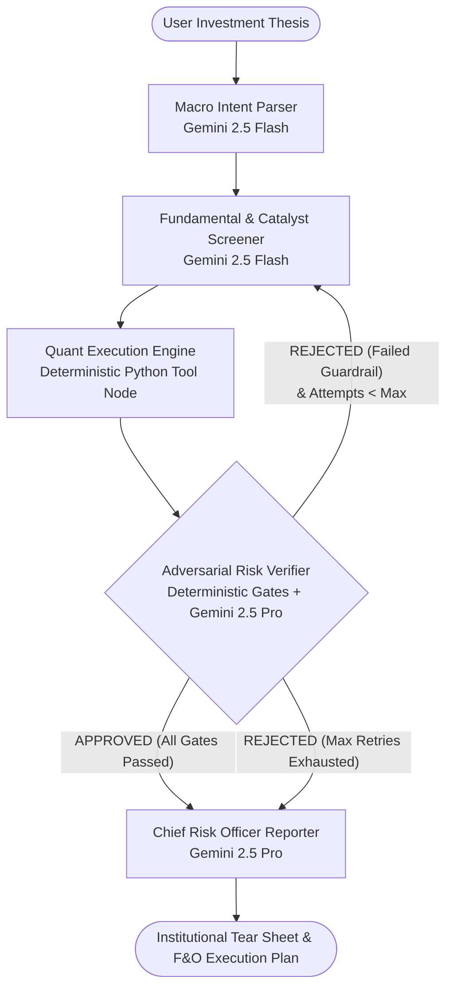
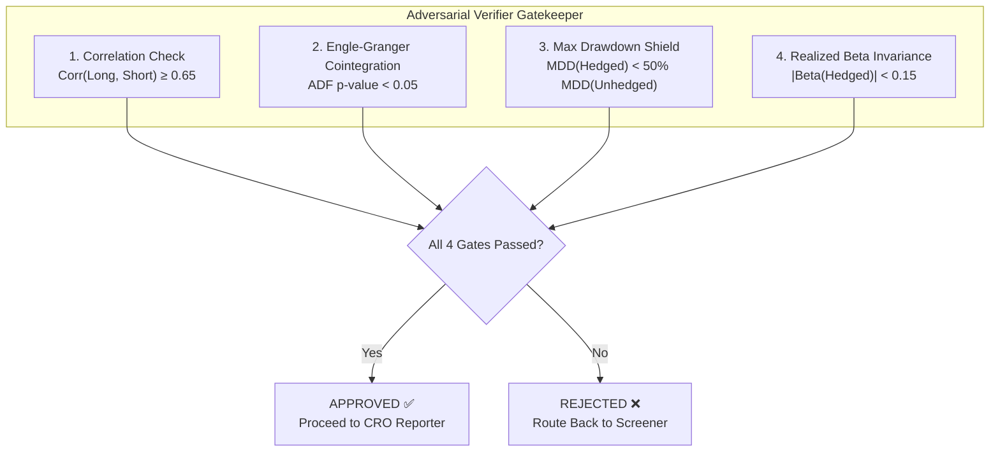

# 🏗️ System Architecture Specification

## 1. Executive Summary & Architectural Philosophy

The **Market-Neutral Hedge Builder** resolves a fundamental dichotomy in contemporary AI applications for financial services:
* **Large Language Models (LLMs)** excel at qualitative synthesis, unstructured text ingestion, semantic reasoning, and macro sentiment analysis, but **frequently hallucinate numerical calculations**, cannot invert covariance matrices reliably, and fail basic statistical tests.
* **Deterministic Econometric Engines** compute exact eigenvalues, cointegration statistics, and risk-adjusted return ratios with machine precision, but **cannot read macro headlines**, cannot interpret geopolitical nuance, and lack flexible reasoning.

To build an institutional-grade platform, the system strictly enforces the **Golden Invariant**:

> **LLMs never guess numbers, and math models never read the news.**

Every quantitative figure—Beta ($\beta$), Sharpe Ratio, Maximum Drawdown (MDD), Engle-Granger $p$-value, Ornstein-Uhlenbeck half-life, and F&O lot sizing—is computed inside deterministic Python execution environments. The LLM acts exclusively as a **portfolio manager, screener, and qualitative gatekeeper**, reading validated numbers from state and deciding strategy.

---

## 2. Global Topology & Agent StateGraph

The multi-agent orchestration layer is constructed on **LangGraph**, utilizing a stateful, cyclical graph topology with an adversarial verification feedback loop.



### Self-Correction Loop Mechanics
When the Quant Execution Engine computes metrics for a proposed pair (e.g., Long TCS / Short TechM) and finds that the Engle-Granger cointegration $p$-value is $0.18$ ($> 0.05$), the **Adversarial Risk Verifier** halts execution, registers an entry in `state.rejection_log`, increments `state.attempt_count`, and triggers a conditional edge backward to the **Screener Agent**.

The Screener inspects the rejection log, excludes the failed pair from consideration, re-ranks candidate combinations, and nominates the next best alternative (e.g., Long TCS / Short Wipro).

---

## 3. Node Specifications & Execution Pipeline

| Node | Type | Engine / Model | Primary Function | Input State Keys | Output State Keys |
| :--- | :--- | :--- | :--- | :--- | :--- |
| **`macro_parser`** | LLM Agent | `gemini-2.5-flash` | Extracts structured sector, benchmark, lookback, and stress regime from natural language thesis. | `thesis` | `target_sector`, `benchmark`, `lookback_days`, `stress_regime` |
| **`screener`** | LLM + Tool | `gemini-2.5-flash` | Retrieves constituents, scores fundamentals, checks news catalysts, and selects candidate pair. | `target_sector`, `rejection_log`, `attempt_count` | `selected_long`, `selected_short`, `long_candidates`, `short_candidates` |
| **`quant_engine`** | Deterministic Tool | Python `numpy`/`scipy`/`pandas` | Downloads prices, computes static & EWMA Beta, cointegration, weights, backtests, and stress tests. | `selected_long`, `selected_short`, `benchmark`, `lookback_days`, `stress_regime` | `pair_metrics`, `weights`, `unhedged_stats`, `hedged_stats`, `stress_results`, `fno_execution` |
| **`risk_verifier`** | Adversarial Agent | Deterministic Rules + `gemini-2.5-pro` | Evaluates pair against 4 institutional gates. Approves or triggers loop back to screener. | `pair_metrics`, `unhedged_stats`, `hedged_stats`, `stress_results` | `approved`, `verifier_result`, `rejection_log`, `attempt_count` |
| **`cro_reporter`** | Institutional LLM | `gemini-2.5-pro` | Synthesizes full quant tear-sheet, rejection audit trail, risk memo, and F&O execution guide. | All state keys | `cro_report` |

---

## 4. LangGraph State Schema (`HedgeBuilderState`)

The complete state carried across all nodes is defined in `agents/state.py` extending `langgraph.graph.MessagesState`:

```python
class HedgeBuilderState(MessagesState):
    # Macro intent
    thesis: str = ""
    target_sector: str = ""
    benchmark: str = "^NSEI"
    lookback_days: int = 252
    stress_regime: str = "COVID_2020"
    
    # Screening results
    sector_tickers: list[str] = Field(default_factory=list)
    long_candidates: list[dict] = Field(default_factory=list)
    short_candidates: list[dict] = Field(default_factory=list)
    selected_long: str = ""
    selected_short: str = ""
    
    # Quant results (Zero-Hallucination Sandbox)
    pair_metrics: dict = Field(default_factory=dict)
    weights: dict = Field(default_factory=dict)
    unhedged_stats: dict = Field(default_factory=dict)
    hedged_stats: dict = Field(default_factory=dict)
    stress_results: dict = Field(default_factory=dict)
    cumulative_returns: dict = Field(default_factory=dict)
    
    # Verification & Self-Correction
    verifier_result: dict = Field(default_factory=dict)
    rejection_log: list[dict] = Field(default_factory=list)
    attempt_count: int = 0
    max_attempts: int = 5
    
    # Final Output
    approved: bool = False
    cro_report: str = ""
    fno_execution: dict = Field(default_factory=dict)
```

---

## 5. Mathematical Guardrail Gates

The **Adversarial Risk Verifier** checks four non-negotiable quantitative criteria before approving any pair for live execution:



### Guardrail Rationales
1. **Correlation Gate ($\rho \ge 0.65$):** Prevents cross-sector pseudo-hedging (e.g. hedging an IT stock with a cement stock). The two assets must share common macroeconomic factor exposure so that systematic market noise cancels out.
2. **Cointegration Gate ($p < 0.05$):** Proves that the spread between the two stocks is integrated of order zero ($I(0)$). Without cointegration, two highly correlated stocks can diverge permanently, leading to catastrophic compounding losses on the short leg.
3. **Max Drawdown Shield ($\text{MDD}_{\text{Hedged}} < 0.50 \times \text{MDD}_{\text{Unhedged}}$):** Guarantees that the market-neutral hedge cut peak-to-trough crash severity by at least half during the designated crisis window.
4. **Realized Beta Invariance ($|\beta_{\text{realized}}| < 0.15$):** Validates that ex-post market exposure was effectively suppressed to zero during the stress test, confirming true market neutrality.

---

## 6. Indian Market Execution Architecture (F&O & Friction)

In Indian equity markets governed by SEBI regulations, **short-selling cash equities intraday is permitted, but carrying short equity positions overnight is prohibited** without Securities Lending and Borrowing (SLBM). Consequently, institutional market-neutral pairs are implemented via **NSE Futures & Options (F&O)**:

1. **Lot Size Normalization:** Percentage weights ($w_L, w_S$) are translated into integer quantities of exchange-mandated lot contracts:
   $$\text{Lots}_i = \text{round}\left(\frac{\text{Capital} \times |w_i|}{P_{i} \times \text{LotSize}_i}\right)$$
2. **Transaction Cost Ingestion:** Round-trip friction is modeled into all backtests:
   * Brokerage: $0.10\%$ ($10\text{ bps}$)
   * Securities Transaction Tax (STT) on futures sell leg: $0.0125\%$
   * GST on brokerage: $18\%$
   * Stamp duty: $0.002\%$
   * Total round-trip drag: $\approx 0.12\%$

---

## 7. Fault Tolerance & Graceful Degradation

The platform is designed to run reliably under hackathon conference network conditions:
* **Local CSV Caching:** Historical prices fetched via `yfinance` are saved to `data_cache/` with date-stamped file keys. Repeat queries hit local disk in $<5\text{ ms}$.
* **Synthetic Fallback Generator:** If public Wi-Fi blocks Yahoo Finance or rate limits IP addresses, the data fetcher activates a deterministic Geometric Brownian Motion fallback preserving historical covariance structures.
* **Deterministic Fallback Memo:** If LLM API quotas are temporarily exhausted, the system renders a rule-based structured executive memo directly from computed state metrics.
